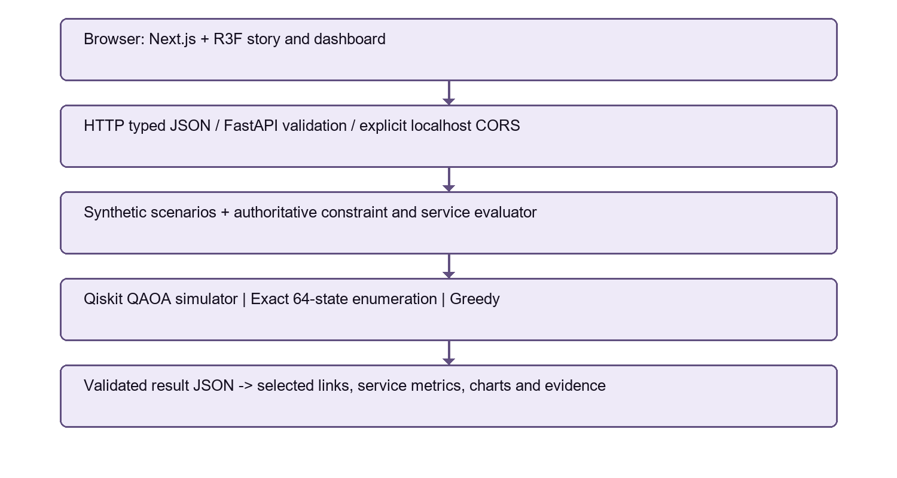

# Tadbeer-o-Taqdeer — تدبیر و تقدیر

**Where Strategy Shapes Destiny.**

We are students from Pakistan. Floods can leave rural communities without bridges, hospital access, electricity or water. Repair budgets are limited, so everything cannot always be restored at once. We asked: **which combination of repairs restores the most important services within the available budget?**

A hospital road alone is not enough if the hospital has no power. Tadbeer-o-Taqdeer explores these connections using six repair decisions in a fictional Pakistan-inspired valley. We chose **Disaster Response** because restoring essential services after damage is the central problem. Choosing cheap repairs first is a hypothetical simple strategy, not a claim about how any government operates.

**The model, costs and valley are fictional. The Qiskit circuit computations are genuine.** This is a research and learning prototype, not an emergency decision system.

Team: **Umer Asif, Ali Irtiza, Abdullah Khalil — FAST-NUCES Islamabad**
Qiskit Fall Fest 2026

## What the website does

The Next.js website presents a cinematic 3D valley and an interactive planning dashboard. Choose a scenario, budget and algorithm, then click **Run Optimization**. The browser requests a real calculation from the Python backend and displays the selected repairs, service score, costs and supporting evidence. Run QAOA, Exact and Greedy for the same inputs to compare them.

- **QAOA** is a quantum optimization method. Qiskit builds and executes a six-qubit circuit on a noiseless simulator. A classical optimizer adjusts its angles, then the circuit is measured.
- **Exact** checks all 64 possible repair combinations and gives the reference optimum.
- **Greedy** adds the action with the best positive score improvement per cost, one step at a time. It can miss useful combinations.

The Urdu identity is real, selectable RTL Nastaliq text. The rest of the interface is primarily English.

## One recorded result

Source: [nine-case benchmark JSON](experiments/results/benchmark-phase3-seed42.json). Synthetic valley flood, budget 9, seed 42, p=1 (one QAOA layer pair), 512 measurement shots:

| Method | Service score | Cost | Selected plan |
| --- | ---: | ---: | --- |
| QAOA best feasible observed sample | 96 | 8 | Temporary crossing + hospital road + electricity feeder |
| Exact | 96 | 8 | Same three repairs |
| Greedy | 95.5 | 9 | Temporary crossing + hospital road + solar backup + pump generator |

QAOA's plan is `011100` in action order x0…x5. Of 512 sampled measurements, 448 were feasible (87.5%). Recorded QAOA runtime was about 285 ms; this is a saved local measurement, not a promise about another machine. All nine saved best observed QAOA scores matched Exact. **All nine optimizers reached the 60-evaluation cap without reporting convergence.**

Scores reward hospital service (50), water (30), crossing connectivity (15) and hospital power (5), then subtract half the cost. The example scores `50 + 30 + 15 + 5 - 0.5 × 8 = 96`. These are abstract service weights and planning units, not people saved or PKR.

**No quantum advantage is claimed.** There are only six decisions, no physical quantum hardware, one seed per case and an exponentially constructed energy table. Exact is already very fast for this tiny instance. See [model details](docs/MODEL.md) and the [Word report](docs/report.docx).

## How data moves

User chooses scenario and budget → clicks Run Optimization → frontend sends a request to FastAPI → the selected real algorithm runs → the backend evaluator checks the plan → the website displays selected repairs, scores and diagnostics.

QAOA selects only from measured feasible samples. Exact is used as a reference, never as a silent replacement for a failed QAOA result. A failed backend request remains an error. A cinematic illustration or explicitly labelled preview is **not** a computed solution. Saved benchmark JSON is recorded evidence, not a new live run. The quantum evidence panel retains the QAOA run for the current inputs while you compare other algorithms.



## File map

| Path | Purpose |
| --- | --- |
| `backend/raasta/quantum.py` | Real Qiskit QAOA algorithm, circuit, optimizer and measured samples |
| `backend/raasta/energy.py` | Converts repair scores and rule penalties into quantum energies |
| `backend/raasta/evaluator.py` | Checks repair choices, constraints and utility |
| `backend/raasta/exact.py` | Tries all 64 combinations |
| `backend/raasta/greedy.py` | Simple classical alternative |
| `backend/raasta/api.py` | FastAPI server connecting website and solvers |
| `backend/raasta/scenarios.py` | Three fictional disaster scenarios |
| `backend/tests/` | Quantum, model and API tests |
| `frontend/` | Interactive Next.js / TypeScript / Three.js website |
| `frontend/src/lib/api.ts` | Browser communication with FastAPI |
| `experiments/results/` | Real saved experimental results and evidence |
| `docs/report.docx` | Final project report with embedded diagrams |
| `docs/architecture.png` | Application architecture diagram |
| `docs/dependencies.png` | Infrastructure service dependency diagram |
| `docs/MODEL.md` | Detailed model and energy explanation |
| `scripts/build_report.py` | Rebuilds the report from saved results, without rerunning QAOA |
| `backend/requirements.lock.txt`, `frontend/package-lock.json` | Pinned dependencies |

The original specifications remain in `MASTER_PLAN.md` and `PHASE_1_QUANTUM.md` through `PHASE_3_INTEGRATION.md`. Historical progress is in `docs/PROGRESS.md`; it is not the current setup guide. The internal Python package name remains `raasta` for compatibility.

## Windows PowerShell setup

Requirements: **Python 3.12+**, **Node.js 22+** and npm, plus Git. Development used Python 3.12.10 and Node 24. Use the pinned dependencies. Commands below assume the repository is at `C:\Hackathon`; adjust the path for your checkout. Do not recreate a working environment unnecessarily.

For a new checkout:

```powershell
git clone https://github.com/Umer-91/tadbeer-o-taqdeer.git C:\Hackathon
cd C:\Hackathon
py -0p
py -3.12 -m venv .venv
.\.venv\Scripts\python.exe -m pip install -r backend/requirements.lock.txt
.\.venv\Scripts\python.exe -m pip install --no-deps --no-build-isolation -e backend
cd frontend
npm ci
npm run build
```

If Python 3.12 is not installed, select your installed Python 3.12-or-newer interpreter when creating the environment. There is no need to activate the environment or change PowerShell execution policy.

**Terminal one — backend:**

```powershell
cd C:\Hackathon
.\.venv\Scripts\python.exe -m uvicorn raasta.api:app --host 127.0.0.1 --port 8000
```

**Terminal two — frontend:**

```powershell
cd C:\Hackathon\frontend
npm run start
```

Open [the website](http://127.0.0.1:3000) and [interactive API documentation](http://127.0.0.1:8000/docs). Keep both terminals running. `npm run start` uses the production build; after changing frontend code, run `npm run build` again. For development, use `npm run dev` instead.

If port 8000 is already occupied, first check the existing server rather than starting duplicates:

```powershell
Invoke-RestMethod http://127.0.0.1:8000/api/health
```

A working backend returns `status: ok` and `qiskit_available: True`. This health check alone does not prove an optimization ran.

### Existing project machine only

If `node` or `npm` is not on PATH, this machine already has a bundled Node runtime and a local npm CLI. The following startup route was used successfully here; other machines should install normal Node.js and use npm above:

```powershell
$env:Path = "C:\Program Files\WindowsApps\OpenAI.CodexPrimaryRuntime.v26-1111-570-0_26.1111.570.0_x64__3k8sg7r9htsxt\dependencies\node\bin;" + $env:Path
cd C:\Hackathon\frontend
node C:\Hackathon\.tools\npm\package\bin\npm-cli.js run start
```

Replace `start` with `build`, `test` or `ci` when needed. `.tools` is local tooling and is not distributed in Git. The full fresh-machine installation above is provided for reproduction; it is not a claim that it was tested on a second physical machine.

## Tests and experiments

From the root, run core model checks or the complete backend suite (which includes genuine small Qiskit tests):

```powershell
cd C:\Hackathon
.\.venv\Scripts\python.exe -m pytest -q backend/tests/test_model.py
.\.venv\Scripts\python.exe -m pytest -q backend/tests
cd frontend
npm test
npm run typecheck
```

To deliberately reproduce all nine benchmarks, choose a **new filename**. This runs actual QAOA; it is unnecessary just to view the saved report or results.

```powershell
cd C:\Hackathon
$run = "experiments/results/benchmark-$(Get-Date -Format 'yyyyMMdd-HHmmss').json"
.\.venv\Scripts\python.exe experiments/run_benchmarks.py --seed 42 --shots 512 --maxiter 60 --output $run
.\.venv\Scripts\python.exe experiments/verify_results.py $run
```

The runner refuses to overwrite an existing file. The verifier checks saved results and provenance; changing solver source after a run can invalidate its source-hash checks. Preserve the original measured JSON.

## Submission materials and credits

- [Word report](docs/report.docx), with application and dependency diagrams embedded.
- [Submission checklist](docs/submission_checklist.md).
- Team-recorded video is uploaded separately; no private recording script is stored here.

Qiskit and Qiskit Aer execute the quantum workflow. FastAPI serves the API; Next.js, React Three Fiber, Three.js and GSAP support the website. Noto Nastaliq Urdu and Manrope font licenses are in `frontend/public/licenses`. The valley is a procedural illustration, not GIS data.

Future real-world work would require verified infrastructure data, expert review, uncertainty and repair-time modelling, stronger classical comparisons, and a scalable formulation. This prototype must not guide actual emergency operations.
